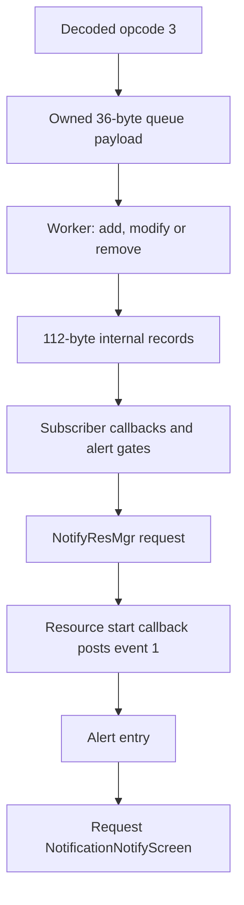

# Native notification queue, storage and alert route

The selected Android legacy-notification path is now followed from the wire
dispatcher to the request to open `NotificationNotifyScreen`. This connects the
[previous synthetic live packet](NOTIFICATION_ACTIONS_AND_ROADSTR.md) to concrete
native consumers. It is static control-flow evidence: the watch screen was not
observed, and this follow-up performed no phone/watch interaction.

The scope is OTA 4.6.0.3, main member SHA-256
`a751910b1a4fdbe75f7e4a5cf38c8992f99e2de02c74283125a62f72ed8abafa`.
Startup copies, the save/restore call fixups and the returning logger are
required. The old exports often stopped at the first log call; their apparent
function lengths were misleading. Selected corrected exports and four reviewed
instruction ranges are fingerprinted in [notification-pipeline.json](notification-pipeline.json).
No vendor C exports or firmware bytes are committed.

## Concrete Android listeners

Initializer `0x7020df76` calls Android API slot `+4` with pointer array
`0x709e4e28`, count 2 and a 16-byte options object. The options words are
`[0, 0, 0x01010101, 1]`; their individual feature meanings are not all assigned.
It registers settings/focus callbacks separately. The adjacent iOS registration
uses different records and is outside the Android record decoder.

Each Android array element points to a six-word record: a name and five
callbacks. Startup-aware reconstruction gives:

| Record / role | Message listener `0x70f697f0` | Call listener `0x70f6195c` |
| --- | --- | --- |
| name | `notification_message` | `androidCall_Info` |
| `+4`, legacy message | `0x704dae72` | `0x70278c7e` |
| `+8`, reply result | `0x704d613e` | null |
| `+0x0c`, logo result | `0x704d1eb2` | null |
| `+0x10`, message-image result | `0x704d8eb0` | null |
| `+0x14`, rich message | `0x704d46cc` | null |

Dispatcher `0x7038946a` calls `+4` after successful legacy opcode-3 decoding.
The message listener skips category 3. The separate call listener requires
title and phone-number pointers before entering its call-reminder path. This
does not establish working call/audio behavior; no call was executed.

The rich callback handles opcode `0x31` separately and copies action/string
data before posting worker `0x704dd698`. Its complete wire/store/UI contract
has not been recovered by this pass.

## Owned queue payload and ordinary store

Listener `0x704dae72` allocates an envelope with a 36-byte payload through
`0x70304222`. It copies the notification's scalar fields and allocates owned
copies of nonempty strings before posting worker `0x704dcf18` via
`0x7030431c`, using the current task from `0x70307420`. These process-local
pointer structures are not another wire format. Special `STICKY_` handling
can copy a larger auxiliary object and remains outside the host model.

Before handling the event, the worker checks the logo cache. The ordinary
missing-logo branch requests numeric format 5 at 128 × 128 through
`0x704d6a5e`. This corroborates the request observed after the synthetic live
notification, without establishing that the text or icon was rendered.

| Wire event byte | Worker behavior |
| --- | --- |
| 0 | construct a new record through `0x704dc928`, admit it through `0x704dc528`, notify consumers |
| 1 | find existing UID, replace its data and emit internal change kind 2; skip if missing |
| 2 | find existing UID and remove it with internal change kind 1; skip if missing |

Other event values have a separate sticky-notification branch; they are not
assigned general add/update/delete meanings here. New-arrival handling does
not provide a general UID deduplication step. An Android companion should keep
stable UID mapping and use the explicit modification event for updates.

The ordinary array starts at `0x70fc2e80`, has 112-byte records, and its count
is at `0x70f8f7c0`. Lookup `0x704d1c34` scans UID word `+0x28` linearly.
Selected record fields are:

| Offset | Meaning supported by this route |
| --- | --- |
| `+0x12` | storage/expiry discriminator; not the notification category |
| `+0x18` | expiry comparison value |
| `+0x1c` | arrival time value |
| `+0x20` | raw word used as zero/nonzero eviction priority |
| `+0x24` | normalized notification type: category 5 → 1, category 1 → 2, otherwise 0 |
| `+0x28` | notification UID |
| `+0x30` | app-ID pointer |

On construction, category 5 and category 1 app IDs are canonicalized to
`android.sms` and `android.email`, respectively. This does **not** identify the
separate discriminator at `+0x12`. That discriminator's value-2 admission
branch still contains unresolved stack/tail-call decompilation and is excluded
from modeled behavior.

The reviewed ordinary admission branch performs these operations:

1. Run pre-change callbacks and expiration. The expiry sweep `0x704db5fe`
   removes records whose discriminator is 1 and whose `+0x18` value is strictly
   less than the current time value. Time units are not established here.
2. If the incoming timestamp is earlier than the first stored timestamp,
   remove existing records through the normal removal path.
3. Scan matching app IDs. On reaching the twentieth match, remove one selected
   from those first twenty: prefer zero at `+0x20`, then the smaller unsigned
   timestamp, then the later scanned record for equal values. The word's full
   UI meaning is unassigned. This is a threshold rule, not proof that every
   possible prior state contains at most twenty records per app.
4. At 400 records, remove the last record. Shift 399 record slots right and
   insert the new record at the front, then increment the count.

Raw instructions at `0x704dc604` and `0x704dc89a` supply both app-ID arguments
to the comparison, even though pseudocode omits one. Instructions
`0x704dc8aa`–`0x704dc8dc` corroborate the priority, unsigned age comparison,
tie behavior and twentieth-match boundary. The capacity and insertion
instructions are at `0x704dc7ea`–`0x704dc836`.

The **400-slot internal store** differs from the **maximum 100 advertised on
the wire** in the earlier session. Neither number should be substituted for
the other or assumed to describe the number of visible UI rows.

## Subscribers and the standard alert route

The service has three subscriber slots at `0x70fc2840`, each containing a
callback-table pointer and a context. Registration `0x704d9204` requires a
non-null table, first callback and context, then takes the first empty slot;
it logs and returns if full. Removal `0x704d9250` clears the first matching
context. Adapter `0x704d1516` registers table `0x70f697e4`, whose callbacks
are `0x704d1424`, `0x704d1406`, `0x704d1414`.

The first callback's internal event kinds differ from the wire event byte:

| Internal kind | Meaning |
| --- | --- |
| 0 | new arrival |
| 1 | removal; callback receives a zeroed record |
| 2 | modification |
| 3 | pre-change callback; its record argument is not established as valid |

Change dispatcher `0x704db476` remembers the UID, runs pre-change callbacks,
then re-finds the UID before acting. This matters because callbacks can change
indices. It copies the record for change delivery; removal frees/compacts the
array and zeroes that copy before invoking subscribers.

Arrival notifier `0x704d9dc0` delivers kind 0 to subscribers before considering
the default alert. If a subscriber exists, it skips the default launch branch;
that alone is not evidence of a dropped notification. Adapter `0x704d1424`
can continue to the resource request after its client arrival callback and
gate checks.

The standard route, when its conditions permit, is:



Specifically, `0x704d18f8` requests `NotifyResMgr` through `0x704c7b54`.
Its start callback `0x704d18a6` posts event 1 to `0x704d16b2`; that worker
calls alert entry `0x704d98c6`. With no overriding alert hook at
`0x70f8f7b0`, the entry passes the name `NotificationNotifyScreen` to slot
`+0x10` of the interface returned by `0x701e0eac`. Its 16-byte argument object
contains the record pointer, UID, an optional auxiliary path pointer and zero.
The final indirect call and screen-name address calculation are corroborated
at `0x704d9aa4`–`0x704d9abc`.

Gate diagnostics identify health measurement, non-wear status, sport/DND and
map-download conditions that can prevent this default request. Explicit active
screen exclusions include Find Phone, Bluetooth pairing, stopwatch, gesture
calibration, GPS calibration, alarm reminder, flashlight and binding QR code.
Additional conditions and override hooks remain. Storage, subscriber delivery,
resource grant, screen opening and actual rendering are distinct observations.

## Reproduction, tests and remaining work

The groups and address lists in `notification_pipeline.py:SOURCES` enumerate
the selected exports. Regenerate them with `DecompileWithAbi.java` against the
startup-aware main project, in a single Ghidra process at a time. Then run:

```sh
python3 analysis_scripts/notification_pipeline.py firmware/bip6-4.6.0.3.zip \
  --decompiled firmware/decompiled > analysis/notification-pipeline.json
python3 -m unittest discover -s tests -p 'test_notification_pipeline.py' -v
llvm-objdump -d --start-address=0x704dc89a --stop-address=0x704dc8e2 \
  firmware/main-runtime.elf
```

The extractor rejects a main image different from the reviewed hash. Its
listener decoder checks bounds, pointer alignment, names and mapped callback
reads. Seven synthetic tests cover pointer failures, distinct records, matching
app boundaries, priority/age/tie ordering and the first-twenty scan cutoff.
They validate the independent host selector, not native execution. All 204
Python tests pass with the existing signature/cipher dependencies. The JSON
reproduces byte-for-byte from the retained inputs.

Actual rendering and user interaction, all UI policy semantics, storage-class
2, rich/sticky formats and a permitted Roadstr notification handoff remain
open. The selected legacy path now reaches a concrete screen request, so these
remaining steps no longer depend on guessing its listener or queue owner.
