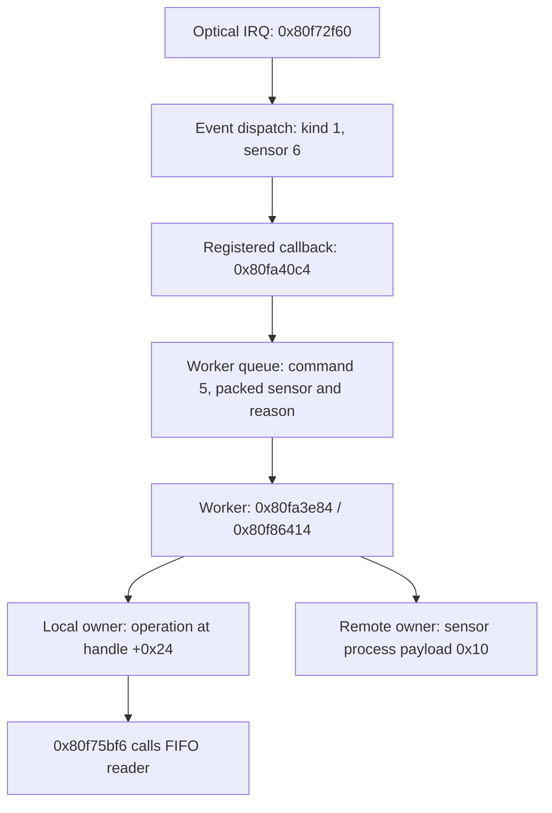

# Optical FIFO, interrupt dispatch and initial sensor IPC payloads

Follow-up: [SPI and timing contracts](OPTICAL_SPI_AND_TIMING.md) resolves the
lower transfer timeout to a strict `delta > limit` check after data movement,
and records the selected controller binding/configuration and error conversion.
[Integrated native register checks](SPI_REGISTER_NATIVE_EXECUTION.md) execute
that order through the upper register wrappers using synthetic inputs;
the batching/FIFO reader remains a separate, not fully executed path.

Static analysis of the sensor-hub member in OTA 4.6.0.3, SHA-256
`06f07541e8bb22b6118f081e791c3a4e40cbff2decd8ee478a7e82df826e9d0f`.
This continues [PPG_AND_SENSOR_MEMORY.md](PPG_AND_SENSOR_MEMORY.md).

## FIFO framing and buffering

Reader `0x80f74526` reads status registers 3 and 4 and computes
`((reg3 & 0xc0) << 2) | reg4`. It rejects counts at least 512, flushes when
count plus cached words exceeds 1000, and rounds reads down to a multiple of
the configured frame-word count. A nonempty SPI transfer sends prefix bytes
`08 80` and requests `2 + 4 * words` bytes, with timeout-like argument 1000.
The first two received bytes are skipped; an echo value is not established.

Four bytes are assembled in big-endian order into each cached word. The
calibration/processing paths interpret channel bits 29–30, measurement bits
24–28 and a signed low-20-bit sample. Bit 31 and bits 20–23 are unclassified.
This is a bundled data format, not proof of the physical ADC resolution.

At each frame start, in a nonzero mode, the driver rejects a word only when
its measurement field is not 1 **and** its channel field is nonzero. The
host model preserves that exact weaker condition; it does not invent a full
channel-sequence validator. The ring buffer at `0x80f5073c` wraps at 1000
words, with read/write/count state around `0x80f1705c`.

Raw LLVM inspection at `0x80f74728` confirms a transfer call immediately
followed by a jump into decoding, without checking its returned status.
The host decoder assumes supplied response bytes are valid input; it does
not reproduce stale-buffer/error behavior as a functional driver contract.
Timeout, overflow and frame-error recovery call `0x80f73906`, which resets
software state and touches registers 9 and `0x0d` through `0x80f738be`.

## Interrupt-to-service route

The optical IRQ callback `0x80f72f60` supplies an eight-byte local message
whose first word is `0x601` and second word is zero. The low byte selects event
kind 1, the next byte identifies sensor 6; this is a sensor-hub ID, distinct
from the JS `hmSensor.id` namespace.



Registration `0x80fa40d4` installs callbacks through `0x80f63886`. Kind 1 uses
slot `0x80f16fa0`; `0x80fa40c4` reads sensor byte `+1` and reason halfword
`+4`, then `0x80fa2cea` queues command 5 with `sensor | reason << 16`.
The queue writer is `0x80fa3ff8` and the worker's case 5 calls `0x80f86414`.
Ownership is determined by mutable capability/processor state through
`0x80f9b23c`; the routing diagram describes the observed branches, not proof
which branch is active on the watch.

For the local path, `0x80f64a18` invokes handle offset `+0x24`. The optical
operation records place `0x80f75bf6` there, which acquires a mutex and calls
`0x80f74526`. Consumer-facing sample conversion remains in the separate
`0x80f747c0` path; an IRQ does not directly produce a final health value.

## Initial inter-processor payload contract

The remote path `0x80f9914e` supplies packet opcode `0x10`, sensor and reason
to serializer `0x80f9a5e6`. The matching parser is `0x80f99ea8`. Their common
integer push/read helpers establish these little-endian payload layouts:

| Family | Wire layout |
| --- | --- |
| Process `0x10` | `opcode:u8, sensor:u8, reason:u16` — exactly four bytes |
| Control `4`, `6`, `7` | `opcode:u8, sensor:u8, command:u16, length:u16, payload[length]` |

The optical IRQ example becomes local bytes `0106000000000000`, queue bytes
`0500000006000000`, and remote process payload `10060000`. These are three
different layers; the local structures must not be sent as wire payloads.
Control data of lengths 1–4 uses integer serialization; the three-byte branch
explicitly writes low, middle and high bytes. Larger data uses the pointed
buffer. The host codec takes payload bytes, preserving their exact order.

Serialized payloads go through `0x80f99c26`, the transport interface returned
by `0x80f95226`, and its send implementation `0x80f94c0a`. Outer zrpc routing,
sequence, fragmentation, checksums, ACK/retry and rpmsg framing were outside
this initial payload model. The follow-up [zrpc packet analysis](ZRPC_PACKETS.md)
recovers link/data/ACK headers, CRC and fragment-descriptor fields on main and
sensor hub; full native reassembly/retry and rpmsg operation remain open.
These sensor payloads are unrelated to the phone-facing BLE framing.

## Register configurations and reproducibility

Eight register/value tables referenced by the mode-selection/control paths
contain 563 ordered writes. The public [ppg-fifo.json](ppg-fifo.json) records
addresses, counts and hashes. Full ordered values stay in ignored
`firmware/ppg-register-tables.json`; duplicate register writes retain their
order. Table meanings and complete mode/timing behavior remain unverified.

```sh
python3 analysis_scripts/ppg_fifo.py firmware/bip6-4.6.0.3.zip \
  --tables-output firmware/ppg-register-tables.json > analysis/ppg-fifo.json
python3 analysis_scripts/sensor_ipc.py firmware/bip6-4.6.0.3.zip \
  --decompiled firmware/decompiled/sensor > analysis/sensor-ipc.json
python3 -m unittest discover -s tests -p 'test_*.py' -v
```

The models have 13 synthetic tests for wire order, signed boundaries, FIFO
count/frame/cache guards, exact lengths, reserved/unknown bits, local versus
wire structures, invalid inputs and preservation of register-write order.
The complete suite has 105 passing tests with the signature dependencies.
Both JSON reports regenerate byte-for-byte; the IPC inventory hashes its
source exports. Host tests check the recovered models, not live hardware.

A fresh startup-aware sensor Ghidra pass with `DecompileFunctions.java`
recovered the reader, register-pair writer, IRQ dispatcher and SPI wrappers.
Its private log is `firmware/ghidra-runtime-sensor-fifo-stdout.log`. The
dispatcher inlines an adjacent event function, and the reader inlines a
recovery branch; inferred boundaries/types still need care. Reproduce using
the startup-aware sensor ELF, AndeStar v5 and `-noanalysis`, with targets
`0x80f86d34 0x80f74526 0x80f72f60 0x80f63f6c 0x80f731ec 0x80f7304c 0x80f73152`.
